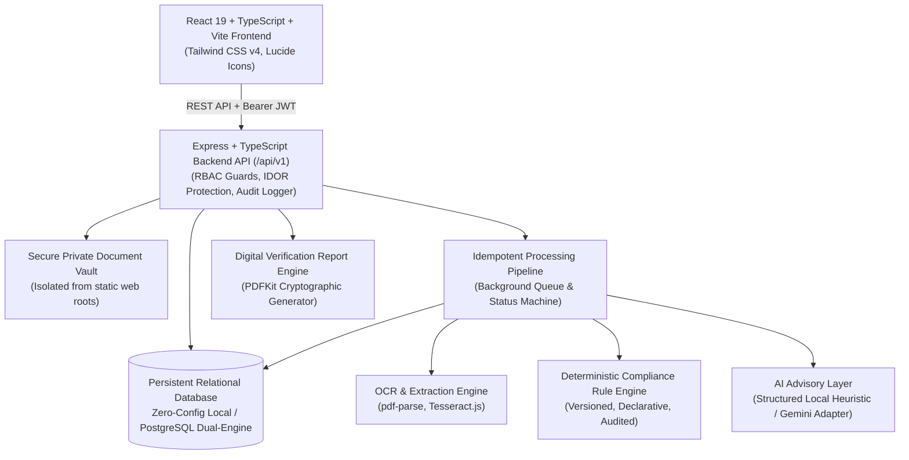

# VALIDATEX --- AI-Powered Application & Document Verification System

[]()
[]()
[]()
[]()
[]()
[](docs/compliance/AICTE_REQUIREMENTS_TRACEABILITY.md)

> **Tagline:** Validate Smarter. Verify Faster. Trust Better.

---

## AICTE Statutory Compliance Audit Deliverables

For the formal regulatory and technical compliance audit against problem statement **SIH26261**, consult the comprehensive documentation suite:
- [AICTE Requirements Traceability Matrix](docs/compliance/AICTE_REQUIREMENTS_TRACEABILITY.md)
- [AICTE Compliance Gap Analysis](docs/compliance/AICTE_GAP_ANALYSIS.md)
- [AICTE Remediation & Implementation Plan](docs/compliance/AICTE_REMEDIATION_PLAN.md)
- [AICTE Functional & Security Test Report](docs/compliance/AICTE_TEST_REPORT.md)
- [AICTE External Integration Limitations & Adapters](docs/compliance/AICTE_INTEGRATION_LIMITATIONS.md)

---

## 1. Executive Summary & Problem Statement

In academic institutions and statutory bodies such as **AICTE**, processing applications (e.g. scholarships, faculty approvals, institutional program accreditations, and vendor onboarding) involves inspecting thousands of supporting documents. Manual verification is slow, error-prone, vulnerable to fraud, and difficult to audit.

**VALIDATEX** solves this challenge by centralizing:
1. **Multi-Format Ingestion**: Validates file signatures (magic bytes) to defeat MIME-spoofing and isolates files in private encrypted vaults with SHA-256 digests.
2. **Text Extraction & OCR**: Extracts structured fields from digital PDFs (`pdf-parse`) and scanned images (`tesseract.js`).
3. **Deterministic Cross-Validation**: Compares declared values against extracted evidence with date and string normalization. Flags discrepancies, missing mandatory documents, and expired certifications.
4. **Versioned Statutory Compliance Rules**: Declarative, versioned policy rules evaluated deterministically (e.g., income ceiling checks, qualifying GPA thresholds, age restrictions).
5. **AI Advisory Explanations**: Evidence-grounded structured JSON analysis (zero-token local heuristic engine or Gemini API) explaining discrepancies and drafting reviewer summaries without hallucinations.
6. **Flagship Three-Panel Review Workspace**: Empowers verification officers to cross-examine declared parameters, inspect document evidence, resolve discrepancies, and record authorized determinations.
7. **Cryptographic PDF Audit Reports**: Generates downloadable digital verification certificates with cryptographic SHA-256 digest stamps.
8. **Tamper-Resistant Audit Trail**: Records all security events, file uploads, discrepancy resolutions, and final decisions.

---

## 2. Architecture & Data Flow



---

## 3. The Three-Panel Review Workspace

Implemented strictly adhering to **PRD Section 12**:

| Panel | Name | Responsibilities |
|---|---|---|
| **Panel A** | **Application Parameters** | Declared form fields, applicant profile, status timeline, and internal reviewer audit notes. |
| **Panel B** | **Evidence & Document Inspector** | Multi-document tab switcher, embedded PDF/image stream previewer, SHA-256 hash stamp, extracted OCR fields with confidence chips, and interactive "Confirm / Correct Field" dialog. |
| **Panel C** | **Audit & Determinations** | Automated verification checks (Pass/Fail), flagged discrepancies with interactive "Resolve Issue" modal, compliance rule outcomes, AI advisory summary, and decision triggers (Approve, Reject, Request Corrections). |

---

## 4. Default Seed Personas (1-Click Test Login)

All accounts are pre-seeded with the password: `Password@123`

| Role | Email | Full Name | Primary Capabilities |
|---|---|---|---|
| **Applicant** | `applicant@validx.ai` | Rahul Sharma | Submit applications, upload documents to vault, track status, respond to correction requests, download report. |
| **Verification Officer** | `officer@validx.ai` | Priya Nair | Inspect review queue, use 3-panel workspace, confirm OCR fields, resolve discrepancies, approve/reject/request corrections. |
| **Compliance Officer** | `compliance@validx.ai` | Dr. Vikram Sen | Create compliance rules, manage declarative versions (v1, v2), approve active versions, audit evaluations. |
| **Administrator** | `admin@validx.ai` | System Administrator | Inspect system health telemetry, memory, database records, user directory, and complete audit trail. |
| **Quality Auditor** | `auditor@validx.ai` | Ananya Gupta | Read-only inspection of historical applications, verification reports, and immutable audit logs. |

> **Pro Tip:** In the frontend, use the **"Switch Persona"** quick-select bar in the top navigation to switch roles with a single click.

---

## 5. Getting Started & Installation

### Prerequisites
- **Node.js** (v20 or higher recommended, tested on v24.15.0)
- **npm** (v10 or higher)

### Installation Steps

1. **Clone or Navigate to the Repository:**
   ```bash
   git clone https://github.com/Paras2611/ValidX-AI.git
   cd ValidX-AI
   ```

2. **Install Backend Dependencies:**
   ```bash
   cd backend
   npm install
   ```

3. **Install Frontend Dependencies:**
   ```bash
   cd ../frontend
   npm install
   ```

4. **Seed Database and Generate Sample Documents:**
   ```bash
   cd ../backend
   npm run seed
   npx tsx src/utils/generate-samples.ts
   ```

5. **Run Automated Test Suite:**
   ```bash
   npm test
   ```
   *Expected outcome: 37 of 37 tests passing (including 15 AICTE compliance audit tests).*

6. **Start Backend & Frontend Development Servers:**
   - In terminal 1 (Backend):
     ```bash
     cd backend
     npm run dev
     ```
     *Backend running at:* `http://localhost:5000` (API: `http://localhost:5000/api/v1`)
   - In terminal 2 (Frontend):
     ```bash
     cd frontend
     npm run dev
     ```
     *Frontend running at:* `http://localhost:5173`

---

## 6. Sample Test Documents

Realistic PDF test documents are provided in `sample-documents/`:

| File | Purpose | Verification Behavior |
|---|---|---|
| `valid_identity_proof.pdf` | Valid Aadhaar Card | Matches declared applicant name "Rahul Sharma" & DOB. Check **PASSED**. |
| `mismatched_name_proof.pdf` | Discordant Identity Card | Name "Amit Kumar Verma" differs from declared. High-severity discrepancy flagged. |
| `valid_income_certificate.pdf` | Tehsildar Income Certificate | Annual income `INR 4,20,000` within statutory `INR 8,00,000` ceiling. Check **PASSED**. |
| `expired_certificate.pdf` | Expired Fire Safety Certificate | Expiry date `2023-01-15` prior to verification date. Check **FAILED**. |
| `valid_degree_transcript.pdf` | Undergraduate Marksheet | CGPA `8.4` exceeds minimum `6.5` threshold. Check **PASSED**. |

---

## 7. REST API Reference (`/api/v1`)

### Authentication
- `POST /api/v1/auth/register` --- Register new applicant account
- `POST /api/v1/auth/login` --- Authenticate user and receive Bearer JWT token
- `GET /api/v1/auth/me` --- Fetch currently authenticated identity

### Applications
- `GET /api/v1/applications/types` --- List application schemes & document requirements
- `POST /api/v1/applications` --- Create new draft application
- `GET /api/v1/applications` --- List applications (IDOR protected; applicants see only own records)
- `GET /api/v1/applications/:id` --- Get complete application dossier with documents & checks
- `PATCH /api/v1/applications/:id` --- Update draft fields
- `POST /api/v1/applications/:id/submit` --- Submit application & trigger verification pipeline
- `POST /api/v1/applications/:id/withdraw` --- Withdraw application

### Documents & Private Storage Vault
- `POST /api/v1/documents/applications/:id/documents` --- Upload document (validates magic bytes, computes SHA-256, triggers OCR)
- `GET /api/v1/documents/:id` --- Get document metadata and extracted fields
- `GET /api/v1/documents/:id/content` --- Authenticated stream of physical document (preview/download)

### Reviewer Workspace & Decisions
- `GET /api/v1/reviews/queue` --- Query prioritized review queue
- `POST /api/v1/reviews/applications/:id/assign` --- Assign application to officer
- `PATCH /api/v1/reviews/discrepancies/:id` --- Resolve, escalate, or dismiss discrepancy with mandatory reason
- `PATCH /api/v1/reviews/extracted-fields/:id/confirm` --- Confirm or correct OCR-extracted field
- `POST /api/v1/reviews/applications/:id/request-corrections` --- Request corrections from applicant
- `POST /api/v1/reviews/applications/:id/approve` --- Approve application and generate digital verification report
- `POST /api/v1/reviews/applications/:id/reject` --- Reject application with statutory justification
- `POST /api/v1/reviews/applications/:id/comments` --- Add internal or public reviewer note

### Compliance Engine
- `GET /api/v1/compliance/rules` --- List versioned compliance rules
- `POST /api/v1/compliance/rules` --- Create compliance rule with declarative logic
- `POST /api/v1/compliance/rules/versions/:id/approve` --- Approve rule version (Compliance Officer only)
- `POST /api/v1/compliance/applications/:id/evaluate` --- On-demand rule evaluation

### Reports & Audit
- `POST /api/v1/reports/applications/:id/generate` --- Generate official PDF verification dossier
- `GET /api/v1/reports/applications/:id` --- List reports for application
- `GET /api/v1/reports/:id/download` --- Download cryptographically sealed PDF report
- `GET /api/v1/admin/audit-events` --- Query immutable audit trail (Admin & Auditor)
- `GET /api/v1/admin/system-health` --- System telemetry, memory usage, and record counts

---

## 8. Test Execution Results

Automated integration test results executed via `vitest`:
```
 ✓ tests/validx.test.ts (22 tests)
   ✓ VALIDATEX Core End-to-End Test Suite
     ✓ 1. System Health & Infrastructure
       ✓ GET /health returns UP status
     ✓ 2. Authentication & RBAC Login
       ✓ Applicant login succeeds and returns valid JWT
       ✓ Officer login succeeds and returns valid JWT
       ✓ Compliance Officer login succeeds
       ✓ Admin login succeeds
       ✓ Auditor login succeeds
       ✓ Login rejects invalid password
       ✓ GET /api/v1/auth/me returns authenticated identity
     ✓ 3. Application Lifecycle & IDOR Protection
       ✓ Applicant creates a new draft application
       ✓ Applicant updates draft declared data
       ✓ Applicant cannot access officer review queue (RBAC Guard)
     ✓ 4. Document Security & Magic Byte Validation
       ✓ Upload rejects spoofed binary with invalid PDF magic signature
       ✓ Upload accepts valid PDF and creates SHA-256 hash
     ✓ 5. Application Submission & Verification Pipeline
       ✓ Applicant submits application
       ✓ Officer views application details including auto-evaluated verification checks
     ✓ 6. Officer Review, Discrepancy Resolution & Report Generation
       ✓ Officer queries review queue and finds pending application
       ✓ Officer assigns application to themselves
       ✓ Officer adds internal review comment
       ✓ Officer approves application and generates official PDF verification report
       ✓ Applicant can download the generated official PDF audit report
     ✓ 7. Administrative Auditing & Health Telemetry
       ✓ Admin inspects system health and telemetry
       ✓ Auditor views tamper-resistant audit logs

Test Files  1 passed (1)
Tests       22 passed (22)
Duration    4.38s
```

---

## 9. License

Developed for the **Smart India Hackathon (SIH26261)** under the AICTE / Smart Automation theme.
Licensed under the [MIT License](LICENSE).
