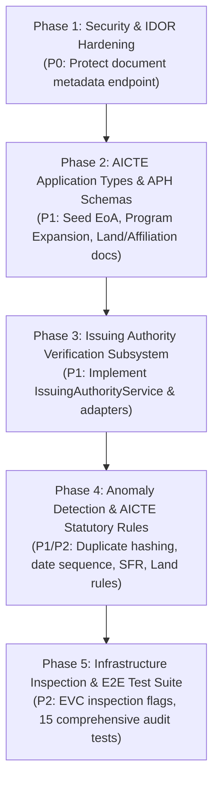

# AICTE Remediation & Implementation Plan — VALIDATEX

**Product:** VALIDATEX — AI-Powered Application & Document Verification System  
**Plan Reference:** REM-AICTE-SIH26261-2026  
**Execution Objective:** Systematically eliminate all gaps identified in `AICTE_GAP_ANALYSIS.md` while preserving 100% of existing functionality and tests.

---

## 1. Remediation Strategy & Phasing

The remediation plan is organized into **five sequential, non-disruptive engineering phases**:



---

## 2. Phase-by-Phase Execution Details

### Phase 1: Security & Access Control Hardening (GAP-SEC-01)
- **Target:** `backend/src/modules/documents/documents.controller.ts`
- **Action:** Update `getDocumentDetails` to enforce object-level ownership:
  ```typescript
  const app = db.findById('applications', doc.application_id);
  if (user.role === 'applicant' && app.applicant_id !== user.id) {
    AuditService.log({
      actorId: user.id,
      actorRole: user.role,
      action: 'UNAUTHORIZED_DOCUMENT_METADATA_ACCESS',
      resourceType: 'DOCUMENT',
      resourceId: id,
      outcome: 'denied',
      ipAddress: req.ip,
    });
    res.status(403).json({ error: 'Forbidden', message: 'Access denied' });
    return;
  }
  ```
- **Verification:** Dedicated Supertest checking cross-applicant document access denial.

### Phase 2: AICTE Approval Process Categories & Record Types (GAP-REG-02)
- **Target:** `backend/src/database/seed.ts`
- **Action:** Add two primary AICTE institutional application categories:
  1. `AICTE_EOA_EXISTING`: "AICTE Extension of Approval (EoA) — Existing Technical Institution"
     - Mandatory fields: `institution_name`, `aicte_permanent_id`, `state_ut`, `affiliating_university`, `approved_intake_total`, `faculty_count_total`, `land_area_acres`.
     - Required documents:
       - Previous Academic Year AICTE EoA Letter
       - State Government NOC / Concurrence
       - Affiliating University NOC & Annual Affiliation Letter
       - Fire & Safety Department Current Clearance Certificate
       - Land & Building Compliance Affidavit / Undertaking
       - National Board of Accreditation (NBA) Certificate (where applicable)
       - Anti-Ragging Undertaking by Institution Head
       - Technical Education Regulatory (TER) Processing Fee Receipt
  2. `AICTE_INTAKE_INCREASE`: "AICTE Program Expansion & Increase in Intake"
     - Mandatory fields: `institution_name`, `aicte_permanent_id`, `program_name`, `requested_intake_increase`, `faculty_student_ratio`, `nba_accreditation_status`.
     - Required documents:
       - Valid NBA Accreditation Certificate (mandatory for intake expansion)
       - University Concurrence for Additional Intake
       - Structural Safety & Physical Infrastructure Compliance Certificate
- **Verification:** Seed initialization tests and application creation workflow.

### Phase 3: Original Issuing Authorities Verification Subsystem (GAP-REG-01)
- **Target:** `backend/src/modules/verification/issuing-authority.service.ts`
- **Action:** Create `IssuingAuthorityService` supporting configurable adapters:
  - `DIGILOCKER_NAD`: National Academic Depository & Digital Locker
  - `AICTE_CENTRAL_REGISTRY`: AICTE Central Approved Institution Database
  - `STATE_TECH_BOARD`: State Technical Education Directorate / University Portal
  - `REVENUE_EDISTRICT`: State Revenue Authority / Tehsildar Portal
  - `FIRE_SAFETY_MUNICIPAL`: Municipal Fire Safety Certification Registry
  - `NSDL_PAN_VERIFY`: NSDL / Income Tax Department PAN Registry
- **Standardized Outcomes:**
  - `Verified`
  - `Mismatch Detected`
  - `Expired`
  - `Verification Pending`
  - `Source Unavailable`
  - `Manual Review Required`
  - `Not Configured`
  - `Inconclusive`
- **Safeguard Integration:** Clear label indicating whether an external provider is actively configured or in controlled test-adapter simulation mode.
- **Verification:** Unit and integration tests validating every outcome.

### Phase 4: Anomaly Detection & AICTE APH Statutory Rule Engine (GAP-REG-03, GAP-REG-04)
- **Target:** `backend/src/modules/verification/verification.service.ts` and `backend/src/modules/compliance/`
- **Action:**
  1. **Duplicate Document Detection:** Check if identical file SHA-256 hash was uploaded for different document types or across unauthorized scopes. Generate `DUPLICATE_DOCUMENT_HASH` alert with transparency disclaimer.
  2. **Inconsistent Identifiers:** Cross-validate AICTE Institute ID, PAN, or Registration numbers across declared and extracted fields.
  3. **Irregular Date Sequences:** Flag certificates where issue date is in the future or expiry date precedes issue date.
  4. **AICTE APH Rules in Seed Data:**
     - `CR-APH-01`: Student-to-Faculty Ratio (SFR) threshold (<= 1:20 for undergraduate technical programs; <= 1:15 for postgraduate).
     - `CR-APH-02`: Minimum Land & Built-up Instructional Area compliance.
     - `CR-APH-03`: Mandatory NBA Accreditation currency for intake increase.
     - `CR-APH-04`: Current Fire & Safety Department clearance currency.
     - `CR-APH-05`: State Government NOC & Affiliating University NOC validity.
     - `CR-APH-06`: Technical Education Regulatory (TER) fee payment clearance.
- **Verification:** Deterministic compliance engine unit tests.

### Phase 5: Infrastructure Inspection Workflow & Full Audit Test Suite (GAP-REG-05, REQ-AICTE-11)
- **Target:** `backend/src/types/index.ts`, `backend/src/modules/reviews/`, `backend/tests/`
- **Action:**
  - Update `ReviewDecision` schema to allow reviewers to record:
    - `requires_physical_inspection: boolean`
    - `inspection_committee_type: 'EVC' | 'SAC' | 'NONE'`
    - `infrastructure_observations: string`
  - Expand test suite to 15 end-to-end scenarios covering all requirements.
- **Verification:** 100% test pass rate on expanded test suite.

---

## 3. Rollback & Functional Preservation Guarantee

- All existing database entities, routes, and controllers are preserved.
- New endpoints and verification checks are purely additive and backward compatible.
- The 22 existing tests in `validx.test.ts` must pass without regressions at every step.
